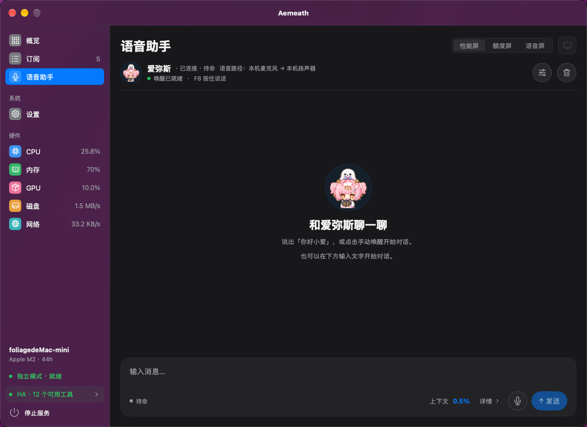

# Aemeath — 性能监控台与爱弥斯语音 Agent

[](https://awesomemygo.dev/apps/aemeath)

Go 采集端（macOS / Windows）通过 Wi‑Fi WebSocket 把 CPU、内存、磁盘、网络、温度、GPU 推送到
Waveshare **ESP32‑S3‑Touch‑LCD‑4B**（480×480 ST7701 + GT911），在 LVGL 多页仪表盘上显示。

**爱弥斯语音助手**支持 ESP32 设备模式与无需 ESP32 的独立模式；独立模式使用电脑系统默认麦克风和扬声器。由电脑离线检测唤醒词（默认“你好小爱”，支持自定义），通过 MiMo ASR → CloudWeGo Eino / OpenAI 兼容模型 → MiMo 音色克隆或 Fish 双向流式合成完成对话。也可使用全局 F8 按住说话。设备上的爱弥斯 Q 版动画随聆听、思考、播报状态切换，桌面端显示对话与工具执行过程。

→ [开始使用](#开始使用) · [下载发布版本](https://github.com/foliageSea/Aemeath/releases) · [网页刷机](https://foliageSea.github.io/Aemeath/) · [语音助手使用说明](docs/voice-agent.md)

**爱弥斯桌宠（P0–P2）**：离线透明角色、点击挥手 / 双击跳跃 / 拖动与短距离散步，独立显示和置顶设置；连接现有 ESP32 助手后共享状态与短回复气泡，不新增麦克风或收费调用。右键或托盘「爱弥斯桌宠」可设置和找回角色。→ [使用说明](docs/desktop-pet.md) · [桌宠验收与平台限制](docs/desktop-pet-validation.md)

```text
agent/      Go 1.27.3+ 采集端 + MyGO 0.8.3 桌面管理端（gopsutil + cgo IOKit / WMI + NVML）
firmware/   ESP-IDF v6.0.2 固件（LVGL 9、esp_lvgl_port、mDNS、esp_http_server WS）
flasher/    Vue 网页刷机工具（Web Serial + esptool-js）
scripts/    统一版本管理与发布构建脚本
docs/       语音、桌宠、自定义背景、通信协议与验证记录
```

## 界面预览



## 版本与自动发版

当前项目版本为 **0.0.4**。根目录 `VERSION` 是统一版本来源，Agent 安装包元数据同步到 `agent/mygo.json`，固件的 ESP-IDF `PROJECT_VER` 直接读取它。

升级版本后提交改动，再为该提交创建并发布 GitHub Release（Tag 使用 `v0.0.4` 或 `0.0.4`，与项目版本一致）：

```bash
python3 scripts/version.py 0.0.4          # 下次发版替换为新的 X.Y.Z
python3 scripts/version.py --check --tag v0.0.4
```

发布 Release 自动触发 `.github/workflows/release.yml`，并行构建 Windows x64、macOS Apple Silicon 与 ESP32-S3 固件，全部成功后上传以下附件及带版本号的 SHA-256 校验文件：

- `Aemeath-Agent-0.0.4-windows-x64-setup.exe`：NSIS 安装包，包含语音原生运行库。
- `Aemeath-Agent-0.0.4-macos-arm64.dmg`：macOS 13+ Apple Silicon 安装镜像，包含语音原生运行库。
- `Aemeath-Firmware-0.0.4-esp32s3.bin`：从地址 `0x0` 烧录的合并镜像，会覆盖镜像间隙中的 NVS / Wi-Fi 配置；保留设置时使用 ZIP 内的分区烧录命令。
- `Aemeath-Firmware-0.0.4-esp32s3.zip`：分区镜像、烧录参数与说明。

推送 `ci/release-build/**` 测试分支会执行相同的全平台构建，并将安装包、固件和校验文件保存在 Actions Artifacts，不上传到 Release。只推送 Tag 或保存 Release 草稿不会触发构建。可在 Actions 手动运行此工作流，填写已有 Release 的 Tag 重建附件；同名附件会被替换。工作流校验 Tag 与项目版本，使用仓库自带的 `GITHUB_TOKEN` 上传，无需额外发布密钥。macOS 默认 ad-hoc 签名、未公证，Windows 默认未签名；离线唤醒模型仍在应用内安装。

本地构建使用同一入口，产物统一放入根目录 `dist/`；Windows 需要 NSIS 和 x64 MinGW-w64 C/C++ 编译器，macOS 需要 Xcode Command Line Tools，固件需要先激活 ESP-IDF v6.0.2：

```bash
bash scripts/build-release.sh windows-x64
bash scripts/build-release.sh macos-arm64
. ~/.espressif/v6.0.2/esp-idf/export.sh
bash scripts/build-release.sh firmware
```

## 开始使用

从 [GitHub Releases](https://github.com/foliageSea/Aemeath/releases) 下载对应平台的桌面安装包：macOS 发布包面向 **macOS 13+ Apple Silicon**，Windows 发布包面向 **x64**；均包含语音原生运行库，离线唤醒模型在应用内另行安装。自行构建可参考下文[桌面端说明](#mygo-桌面端macos--windows)。

| 项目 | 独立模式 | 设备模式（默认） |
| --- | --- | --- |
| 硬件 | 电脑即可，无需 ESP32 | Waveshare ESP32-S3-Touch-LCD-4B，与电脑处于同一局域网 |
| 语音输入 | 系统默认麦克风 | ESP32 设备麦克风 |
| 语音输出 | 系统默认扬声器 | 默认设备扬声器，可切换到电脑扬声器 |
| 设备连接 | 跳过发现与连接 | mDNS 自动发现，或手动填写设备地址 |
| 屏幕功能 | 无设备切页、屏幕电源/亮度与背景控制 | 性能、订阅额度、语音三页及屏幕控制、自定义背景 |

### 无需 ESP32：独立模式

1. 打开桌面“设置 → 连接 → 运行模式”，选择“独立模式”并保存。CLI 使用 `--standalone`，命令见[采集端](#采集端)。
2. 在“设置 → 助手”启用助手并配置 OpenAI 兼容 LLM，在“设置 → 语音”配置 MiMo ASR 和 MiMo 或 Fish 语音合成，点击顶部“保存设置”。
3. 允许麦克风权限，并在系统声音设置中选择默认输入与输出设备。macOS 在“系统设置 → 隐私与安全性 → 麦克风”允许 Aemeath（CLI 允许启动它的终端）；Windows 开启麦克风访问与“允许桌面应用访问麦克风”。
4. 在“语音 → 声音试听”检查参考音频和合成效果，再按住 **F8** 说话；需要语音唤醒时，在“离线唤醒”安装模型并保存设置，默认唤醒词为“你好小爱”。

独立模式仍需联网调用 MiMo ASR、所配 LLM 和 MiMo/Fish TTS；离线能力仅包括唤醒与断句。独立模式自动在电脑播放，即使已保存的播放位置是“监控台”，也只覆盖本次有效输出，不改写该设置。电脑本地播放没有 AEC，播放期间暂停自动唤醒；仍可用 F8、手动唤醒、取消或文字输入打断。

### 使用 ESP32 监控台：设备模式

1. 使用[网页刷机](https://foliageSea.github.io/Aemeath/)或自行构建并烧录固件，按屏幕提示完成 Wi-Fi 配网，让设备与电脑处于同一局域网。
2. 运行 MyGO 桌面端或命令行采集端，通过 mDNS 自动发现设备，也可手动填写设备地址。
3. 使用语音助手时，更新支持音频通道的固件，在桌面“设置 → 助手”启用助手、配置 LLM，再在“设置 → 语音”配置 MiMo ASR 和 MiMo 或 Fish 语音合成。
4. 在“离线唤醒”安装模型并保存设置，随后测试唤醒；也可直接使用 F8 按住说话。完整步骤见[语音助手使用说明](docs/voice-agent.md)。

### 对话语音重播

助手回复下方可点击“重播”，复用已生成的原音频，不重新调用模型或语音合成，也不新增对话与用量。支持停止重播或用新对话打断，按当前会话的播放位置和音量输出。音频仅在本次语音连接内缓存，最多 10 条、合计 5 分钟；清空对话、重连或重启后失效。无缓存时可点击“合成播放”，按当前音色仅调用 TTS（可能产生合成费用），成功后可复用新缓存；恢复的历史文字也支持。详见[对话语音重播](docs/voice-agent.md#对话语音重播)。

### 上下文与用量

语音助手按 Token 预算管理上下文，默认开启“设置 → 助手 → 对话服务 → 自动读取模型上下文容量”（JSON `contextWindowMode: "auto"`；省略也为自动模式）。自动模式仅使用已启用的 **models.dev 公共目录 → 备用容量**，不向对话服务查询模型容量，不调用服务商的模型元数据接口。开启“使用 models.dev 查询上下文容量”（`modelsDevEnabled: true`，默认关闭）后，按目录服务地址和完整模型 ID 精确匹配；中转服务或模型别名可填写 `modelsDevProvider` 与 `modelsDevModel` 显式关联目录条目，不改变实际请求模型。目录下载在后台进行并本地缓存，首次无缓存也不阻塞对话；未启用、未匹配或无可用缓存时立即使用备用值，不发送密钥、对话或自定义服务地址。目录容量不是当前服务的实测上限，中转站可能限制得更小。不猜测模型名称，也不用 usage 反推容量。`contextWindow` 在自动模式下是备用值，关闭自动开关（`"manual"`）后是手动上限：0 或省略默认 **32K（32768 Tokens）**，手填允许 8192–2097152 Tokens；目录值允许 4096–2097152。修改后保存，重连生效。桌面区分“models.dev / 手动设置 / 未获取，使用备用值”，悬浮查看请求模型 ID、目录条目及独立输入上限。

估算输入占用达到预算的 **70%** 时在后台提炼摘要，达到 **85%** 时在下次请求前同步压缩；摘要后优先保留最近 **4 轮**完整问答，硬预算不足时可进一步裁剪。文字对话与摘要跨闲置、设备重连和应用重启持续保留，不因闲置时长自动过期；仍按 Token 预算自动压缩或裁剪，手动清空对话会删除对话与摘要，保留长期记忆。桌面显示估算占用、输入预算、摘要状态和累计用量，累计输入/输出/总计始终标为 **Tokens（本地估算）**；启动后立即恢复上次保存的累计值，无保存用量时从 0 开始。按实际发送的请求（含历史上下文、工具定义和工具结果）及收到的输出（含可见推理和工具调用）在本地估算，覆盖工具决策、回复、摘要与长期记忆提炼请求，非精确分词，不等于服务商计费用量；UI 不展示服务商上报的 usage。本地累计用量持久化保存，每次请求被接受计入输入和响应结束计入输出后即保存，无需等待一轮对话结束；闲置、重连、重启后继续累计，自动压缩或预算裁剪不会清零。本地累计用量仅在手动清空对话时清零，并删除保存的对话与用量记录。

### 长期记忆

“设置 → 助手 → 记忆”默认使用自动模式（`voice.memoryMode: "auto"`，空值也为自动）：从成功对话中提炼长期偏好、资料、事实与目标，后续按需召回。自动提炼每成功轮最多增加一次后台模型调用，10 秒超时、无自动重试，可能产生模型费用；最多保存 200 条，每条正文 256 字符。`explicit` 仅在用户明确要求时保存，仍可召回；`off` 关闭保存与召回，**不会删除已有数据**。`llmTools: false` 仍支持自动提炼和召回；对话中即时通过自然语言“记住 / 忘记”需开启 Agent 工具并使用支持 tool calling 的模型。

桌面支持离线搜索、新增、编辑、删除与确认清空，显示来源、更新时间及后台提炼状态/错误。模式通过顶部“保存设置”生效，条目即时保存；发生版本冲突时保留编辑内容供检查后重试。长期记忆独立保存在设置目录的 `agent_memory.json`；清空对话保留长期记忆，删除长期条目不会删除旧聊天原文。CLI 以 `--memory-file` 指定独立文件，默认系统用户配置目录 `Aemeath/cli_memory.json`。详情见[长期记忆](docs/voice-agent.md#长期记忆)。此功能无需固件改动。

## 固件

```bash
. ~/.espressif/v6.0.2/esp-idf/export.sh
cd firmware
idf.py build
idf.py -p /dev/cu.usbmodem11101 flash monitor
```

首次启动（或长按 BOOT 3 秒清除配网后）进入配网模式：屏幕显示二维码，手机加入
`Aemeath-XXXX` 热点后会弹出配网页（或打开 `http://192.168.4.1`），选择 Wi‑Fi 并保存。
联网后设备广播 `aemeath.local` 与 `_aemeath._tcp`，也可在浏览器访问 `http://aemeath.local/` 重新配网。

### 网页刷机（无需 ESP-IDF）

打开 <https://foliageSea.github.io/Aemeath/>，用桌面版 **Chrome / Edge 89+** 通过 USB 直接刷入发布固件（基于 Web Serial 与 [esptool-js](https://github.com/espressif/esptool-js)）：

1. USB-C 连接开发板，点击“连接”，选择 ESP32-S3 串口；页面会校验芯片为 ESP32-S3、Flash 为 16MB。
2. 点击“开始刷入”。固件下载后先做 SHA-256 校验，写入后再做 MD5 回读校验，完成后自动重启。
3. 在“串口日志”查看启动输出（115200）。

默认只写入 bootloader（0x0）、分区表（0x8000）和 app（0x10000），**保留 NVS 中的 Wi‑Fi 配网与屏幕设置**；勾选“整片擦除”才会清除。“本地文件”页可刷自行构建的 `.bin`（合并镜像填 0x0）。若无法自动进入下载模式：按住 BOOT，短按 RESET，松开 BOOT 后重新连接；并关闭 `idf.py monitor` 等占用串口的程序。

本地开发与构建（源码在 `flasher/`，需要 Node 22 + pnpm，先完成 `idf.py build`）：

```bash
cd flasher
pnpm install
pnpm stage        # 把 firmware/build 产物与 manifest.json 复制到 public/firmware/
pnpm dev          # http://localhost:5173
pnpm test
pnpm build        # stage + 类型检查 + 生成 dist/
```

仅在发布 GitHub Release（`release.published`，包括预发布版本）时，[`.github/workflows/flasher-pages.yml`](.github/workflows/flasher-pages.yml) 才会构建该 Release Tag 对应的固件和网页并部署到 GitHub Pages；推送代码、推送 Tag 或保存 Release 草稿不会触发。首次使用需在仓库 **Settings → Pages** 把 Source 设为 “GitHub Actions”，并在 `github-pages` 环境中允许发布 Tag 部署。要打包发版构建的固件，可运行 `pnpm run stage -- --build-dir ../firmware/build-release`（先执行 `bash scripts/build-release.sh firmware`）。

## 采集端

```bash
cd agent
go run ./cmd/aemeath-agent            # mDNS 自动发现
go run ./cmd/aemeath-agent -addr 192.168.31.207:80
go run ./cmd/aemeath-agent -dry-run   # 只打印 JSON，不连接
CGO_ENABLED=1 go run ./cmd/aemeath-agent --standalone --voice-config voice.local.json # 电脑麦克风/扬声器，无需 ESP32
```

`--standalone` 自动启用语音，无需另加 `--voice`，不可与 `--addr` 或 `--dry-run` 同用。终端支持 `wake`、`record_start` / `record_stop` / `record_cancel`、`text 你的问题` 和 `cancel`，启动日志显示独立模式实际播放位置。更多配置见[语音助手说明](docs/voice-agent.md)。

Windows 交叉编译（无需 cgo；此构建不提供本机音频与离线唤醒能力）：

```bash
GOOS=windows GOARCH=amd64 CGO_ENABLED=0 go build -ldflags -H=windowsgui -o aemeath-agent.exe ./cmd/aemeath-agent
```

- **macOS**：Apple Silicon 通过 IOHID 读取 `PMU tdie*` 温度、IOAccelerator 读取 GPU 占用，无需 sudo。
  首次运行时系统会询问“本地网络”权限，需允许，否则连接会报 `no route to host`。
- **Windows**：NVIDIA GPU 直接读 NVML；CPU 温度及 AMD/Intel GPU 需要后台运行
  [LibreHardwareMonitor](https://github.com/LibreHardwareMonitor/LibreHardwareMonitor)（建议以管理员运行），
  未运行时温度字段省略，屏幕显示 `--`。
- 命令行版本开机自启：macOS 可用 `~/Library/LaunchAgents` plist；Windows 可把 exe 快捷方式放进 `shell:startup`。桌面版本通过设置页管理系统登录项。

## MyGO 桌面端（macOS / Windows）

使用 [MyGO](https://mygo.egoist.dev/) 的纯 Go 原生 UI（macOS 使用 Metal 渲染）与原生托盘 API，不使用 WebView，也不依赖 Bun、Vite 或前端构建。桌面版本与命令行版本是独立入口；使用桌面版本时请先退出已有命令行 Agent，避免两个进程同时向设备推送。

- **托盘运行**：关闭窗口后继续采集与推送；菜单可打开窗口、启动/暂停推送服务、切换设备显示页、退出应用。退出才停止全部后台工作。
- **服务状态**：显示发现中、连接中、已连接、重连、暂停状态，设备地址、最近成功发送时间、连接错误，以及本机 CPU / 内存 / GPU / 网络数据。暂停服务只暂停设备推送，本地指标与额度仍会更新。
- **订阅管理**：从 Magpie 读取完整账户列表，拖动调整顺序，隐藏/恢复账户；排序和显示状态立即保存并应用，最多向设备发送前 8 个未隐藏账户。偏好按网关原始账户名称匹配，改名会被视为新账户；不会修改 Magpie 的数据。
- **连接设置**：设备地址与 Magpie 网关地址编辑后，点击“保存设置”才会保存并应用；后台快照更新不会覆盖未保存的输入。
- **网络代理**：“设置 → 连接 → 网络代理”提供 **系统 / 代理 / 直连** 三种模式，默认系统。系统模式优先使用环境变量，再读取 macOS / Windows 手动系统代理；代理模式支持 `http` / `https` / `socks5` URL，连接失败只报错，绝不回退直连；直连模式忽略代理环境变量和系统代理。仅代理模式显示遮罩 URL 输入，切换模式保留草稿，点击“保存设置”后生效并重连语音（可能中断当前对话）。`localhost`、回环 / 私有 / 链路本地 IP 和 `.local` 地址绕过代理；ESP32 与 Home Assistant 始终直连。不支持 PAC / WPAD，仅配置自动代理时会报错。两个 CLI 均支持 `--proxy-mode system|proxy|direct`（默认 `system`）及 `--proxy-url`，不会读取或修改桌面代理设置；示例与限制见[网络代理说明](docs/voice-agent.md#网络代理)。
- **快速切页**：窗口及托盘均可发送“性能 / 订阅额度”切换指令。需要更新本仓库固件；协议无回执，界面只表示已发送，屏幕手势仍可自行切页。
- **屏幕电源与亮度**：窗口标题栏、设置页与托盘菜单均可远程息屏/亮屏，设置页还可拖动调整亮度（0-100）；屏幕状态以设备为准：设备把息屏/亮度保存到 NVS（调整停止 1 秒后写入），重启后恢复，并在每次连接及每次变化后上报；软件连接时不会覆盖设备状态，设备离线或尚未上报时控件禁用。息屏会同时关闭 ST7701 显示输出（`DISPOFF`），因为板载 AP3032 的使能脚常开，仅靠背光 PWM 无法完全熄灭。
- **自定义背景**：在“设置 → 屏幕 → 监控台背景”选择图片，方形裁剪、压缩并调节图片亮度/对比度，预览后上传。默认无背景图；背景在设备持久保存，三页共享，可移除恢复纯色。需要一起更新固件与分区表，不必清除 NVS。→ [使用、升级及接口说明](docs/background.md)
- **开机自启**：设置页启用系统登录项；登录启动时只驻留托盘。应用要求 macOS 13+，使用系统 Login Items。请先把打包的应用拖入 Applications，再启用此项。

macOS 开发与运行要求 **macOS 13+**。开发需要 Go **1.27.3+**（Go 可自动下载对应 toolchain）和 Xcode Command Line Tools。MyGO 原生 UI 使用纯 Go；macOS 硬件传感器使用 cgo，因此开发、测试和构建需保持 `CGO_ENABLED=1`。

```bash
./agent/scripts/dev.sh
```

开发脚本可从任意目录启动；在终端输入 `r` 后按回车重新构建并重启，输入 `q` 后按回车退出，`Ctrl+C` 也可退出并清理开发进程。修改 Go 代码后自动重新构建；编译失败时保留上一版运行，修正后会再次尝试。开发运行前请退出正在推送的正式版，避免重复推送。额外参数会传给 `mygo dev`，例如 `./agent/scripts/dev.sh -lang zh-CN`。

在 `agent` 目录运行 Go 测试，覆盖原生界面逻辑与后台服务：

```bash
CGO_ENABLED=1 go test ./...
```

打包脚本会生成应用图标，并通过 MyGO 构建原生桌面应用，生成 ad-hoc 签名的 `.app`，并打包为 `.dmg` 安装镜像；全程无需 Bun 或前端资源构建：

```bash
cd agent
./scripts/build-dmg.sh                  # 默认 Universal：Apple Silicon + Intel
./scripts/build-dmg.sh darwin/arm64     # 仅 Apple Silicon
./scripts/build-dmg.sh darwin/amd64     # 仅 Intel
```

产物位于 `agent/build/darwin-universal/`（或 `darwin-arm64/`、`darwin-amd64/`）。默认 ad-hoc 签名；对外分发时可通过 `AEMEATH_SIGN_IDENTITY="Developer ID Application: …" ./scripts/build-dmg.sh` 指定签名，公证选项参见 [MyGO 分发文档](https://mygo.egoist.dev/docs/distribution)。本仓库不包含 Developer ID 或公证凭据。

配置原子写入 `~/Library/Application Support/Aemeath/settings.json`，权限 `0600`；登录项状态读取自系统。日志位于 `~/Library/Logs/Aemeath/agent.log`。设备地址留空使用 mDNS，或输入 IP/主机名（端口默认 80）；首次连接需允许本地网络权限。

### Windows 安装包（macOS / Linux 交叉编译）

需要 Go **1.27.3+**、Bash 和 **NSIS 3**（`makensis` 在 PATH 中）。macOS 安装依赖：`brew install nsis`；Debian / Ubuntu：`sudo apt-get install nsis`。无需 Windows SDK、MinGW 或 cgo。

从仓库根目录运行（脚本也支持从任意目录调用）：

```bash
./agent/scripts/build-windows.sh                  # 默认 Windows x64
./agent/scripts/build-windows.sh windows/arm64    # Windows ARM64
./agent/scripts/build-windows.sh windows/amd64 -o build/release
```

脚本生成图标，强制 `CGO_ENABLED=0`，通过当前模块锁定版本的 MyGO 构建桌面应用和 NSIS 安装程序。额外参数传给 `mygo build`，例如 `-o` 修改输出目录（相对于 `agent`）。默认产物：

- `agent/build/windows-amd64/Aemeath.exe`：桌面应用。直接运行时需保留同目录的资源文件。
- `agent/build/windows-amd64/aemeath-setup-0.0.4-amd64.exe`：可分发的安装包，版本来自 `agent/mygo.json`。
- ARM64 产物位于 `agent/build/windows-arm64/`，安装包名称中的架构为 `arm64`。

安装程序默认安装到当前用户的 `%LOCALAPPDATA%\Programs\Aemeath`，创建开始菜单入口，提供桌面快捷方式选项，并可在系统“已安装的应用”中卸载，无需管理员权限。Windows 开机自启通过桌面设置页管理；温度与 GPU 采集的依赖见上文 Windows 说明。默认安装包未进行代码签名；签名可配置 `agent/mygo.json` 的 `windows.signCommand`，参见 [MyGO 分发文档](https://mygo.egoist.dev/docs/distribution)。

### Windows 语音版

上面的默认 Windows 构建脚本使用 `CGO_ENABLED=0`，不提供本机音频与离线唤醒能力，无法运行独立语音模式。需要这些能力时，使用语音版脚本，额外准备目标架构的 MinGW-w64 / llvm-mingw C 编译器；Go、Bash 和 NSIS 要求相同。GitHub Release 中的 Windows x64 安装包已使用语音版构建：

```bash
# 从仓库根目录构建 Windows x64 语音版
CC=x86_64-w64-mingw32-gcc bash agent/scripts/build-windows-voice.sh windows/amd64
```

脚本启用 cgo 并打包 sherpa-onnx / ONNX Runtime DLL；运行时需保留配套资源。macOS 的 `build-dmg.sh` 已包含对应架构的语音原生库。唤醒模型仍需在应用内安装，具体要求与发布包校验方法见[构建与诊断](docs/voice-agent.md#8-构建与诊断)。

## 爱弥斯语音助手

助手支持两种运行模式：**设备模式**由电脑主动连接 ESP32 的 `/voice` WebSocket，使用设备麦克风，默认由设备扬声器播放，也可切换到电脑扬声器；性能与额度通过 `/ws` 独立推送。**独立模式**使用电脑系统默认麦克风和扬声器，无需设备连接。“设置 → 助手”配置启用状态、角色与对话服务；“设置 → 语音”配置识别、合成、唤醒与试听，顶部“保存设置”统一保存修改。

- **离线唤醒**：默认“你好小爱”，支持 2–12 个模型支持的中文汉字；模型可在桌面端下载安装。待机音频不发送给云端 ASR，唤醒后才识别问题；对话期间再次说出已保存的唤醒词会打断当前对话并立即倾听新问题，可连说“唤醒词 + 新问题”。设备扬声器播放时，新版固件持续采集，并以实际播放 PCM 为参考做本地回声消除；电脑扬声器播放期间暂停自动唤醒，可改用 F8、手动唤醒、取消或文字输入打断。
- **全局按住说话**：按住 **F8** 录音，松开后识别并发送给 Agent，无需先说唤醒词，也不要求离线模型就绪；需要启用语音助手，且当前模式的音频会话已就绪；设备模式还要求设备麦克风未静音。切到其他应用或关闭窗口驻留托盘仍可使用，单次最长 30 秒；按下快捷键会打断当前对话或播报。F8 被占用时自动尝试 **Ctrl + Shift + F8**，实际快捷键或注册错误显示在语音助手页；部分 Mac 键盘需使用 **Fn + F8**。可在“设置 → 助手 → 基础设置 → 触发快捷键”输入自定义组合（如 `F9`、`Ctrl+Shift+Space`、`Cmd+Shift+A`），保存后立即生效并在重启后保留；支持 F1–F24（macOS 最高 F20）、字母、数字和 Space，字母/数字/空格必须搭配 Ctrl、Alt 或 Super（macOS 为 Command，Windows 为 Win）。输入格式错误、组合被占用或保存失败时保留原快捷键；切换成功会取消正在按住的录音，避免误发送。留空或点击“恢复默认快捷键”后保存，可恢复 F8 / Ctrl+Shift+F8 自动选择；显式自定义时不会静默回退。
- **文本输入**：在语音助手页底部输入消息，按 **Enter** 或点击“发送”开始对话，**Shift + Enter** 换行。文字直接交给 Agent，沿用现有上下文、工具调用和所选播放位置的语音回复；需启用助手并让当前模式的音频会话就绪（设备模式需连接设备语音通道），无需唤醒词或麦克风录音。发送失败会保留草稿。
- **对话与历史**：桌面端显示识别文字、回复、阶段耗时及可展开的工具执行记录；最近完整文字对话会持久化并在重启后恢复，可清空上下文。语音合成失败后可仅重试回复语音，避免重复运行工具。
- **播放位置**：设备模式下，在“设置 → 语音 → 声音试听”选择“Agent”或“监控台”，保存后生效；Agent 使用当前电脑的扬声器，监控台使用 ESP32 设备扬声器（默认）。设备模式仍由设备麦克风录音；独立模式固定使用系统默认麦克风和扬声器，不改写已保存的设备模式播放偏好。电脑音频输出失败时提示错误。
- **语音合成**：MiMo 使用 `mimo-v2.5-tts-voiceclone` 分句合成；Fish 支持双向流式音频，可配置 `reference_id` 或参考 WAV 与对应转写文字。语音问题识别均使用 MiMo ASR；Fish 在监控台设备上流式播放需要支持 `stream_playback` 的固件；Agent 电脑端播放不需要设备具备该播放能力。
- **思考强度**：在“设置 → 助手 → 对话服务”选择“默认 / 低 / 中 / 高”，保存后重连生效。低强度优先响应速度，高强度适合复杂分析，实际效果取决于模型与服务支持。该设置同时用于工具决策和最终回复；JSON `voice.reasoningEffort` 使用 `low`、`medium`、`high`，留空或省略时不发送 `reasoning_effort`，沿用服务端默认。
- **Agent 工具**：支持查询性能与订阅额度、切页、屏幕电源/亮度、锁定电脑和 Tavily 网页搜索。需启用“Agent 工具”并使用支持 tool calling 的模型；网页搜索另需 Tavily API Key。独立模式仍提供本机性能与额度查询，切页及屏幕控制会提示设备不可用。
- **当前时间**：每轮对话自动注入电脑系统时钟的本地时间、时区、UTC 偏移与星期快照，同一轮共用采样时刻，下一轮重新采样；关闭 Agent 工具也生效，无需额外查询时间服务。
- **智能家居**：可接入 Home Assistant 官方 MCP Server，通过语音调用 HA 暴露的工具。在“智能家居”配置 MCP 地址、长期访问令牌并测试连接，再保存设置；同时需要开启 Agent 工具。

首次使用建议按“参考音频播放 → 合成试听 → 唤醒或 F8 → 完整对话”的顺序检查。安装资源、API 配置、命令行参数与排障见[语音助手使用说明](docs/voice-agent.md)，协议细节见[语音通信约定](docs/voice-contract.md)，硬件与云端实测范围见[验证记录](docs/voice-validation.md)。

## Magpie 订阅额度页

屏幕左右滑动切换到第二页「AI QUOTA」，显示本机 [Magpie](http://127.0.0.1:3425) 网关聚合的各订阅账户额度：
每个窗口一条进度条（≥75% 黄、≥90% 红）、用量 / 计数、重置倒计时，顶部是今日与 30 天花费和调用次数。
账户按 Agent 发送顺序显示；桌面端可调整顺序和隐藏账户。余额账户（如 jinpai）单独显示名称和带币种的余额（如 `$109.12`）；余额未知时显示 `--`。
余额不参与 USED / LEFT 百分比切换，也不显示进度条或重置倒计时。

- agent 每 30 秒读取 `GET /v1/magpie/quotas` 与 `/v1/magpie/usage` 并转发（不会转发账户邮箱）。
- `-magpie http://host:port` 指定网关地址，`-magpie ""` 关闭；网关不可用时只记日志，不影响性能数据。
- 超过 3 分钟未收到额度数据，页面右上角显示红色 `stale`。

## 协议

每秒一帧 JSON 文本（字段见 `agent/internal/proto/proto.go`，固件解析见 `firmware/main/metrics.c`），
缺失字段直接省略。设备用 `ts` + `tz` 同步时钟。
额度数据是另一种帧（`"type":"quota"`，见 `proto.QuotaFrame` 与 `firmware/main/quota.c`）；没有 `type` 的帧按性能数据处理。
切页指令是 `"type":"display"` 帧（`{"v":1,"type":"display","page":"metrics"|"quota"|"voice"}`）。
屏幕电源/亮度指令是 `"type":"screen"` 帧（`{"v":1,"type":"screen","on":true|false,"brightness":0-100}`，`on` 为 `false` 时关闭显示并熄灭背光，`brightness` 仍被记住用于下次亮屏）。
设备会回传 `{"v":1,"type":"screen_state","on":…,"brightness":…}`（连接时及每次变化后），见 `firmware/main/net/server.c` 与 `firmware/main/display.c`。
